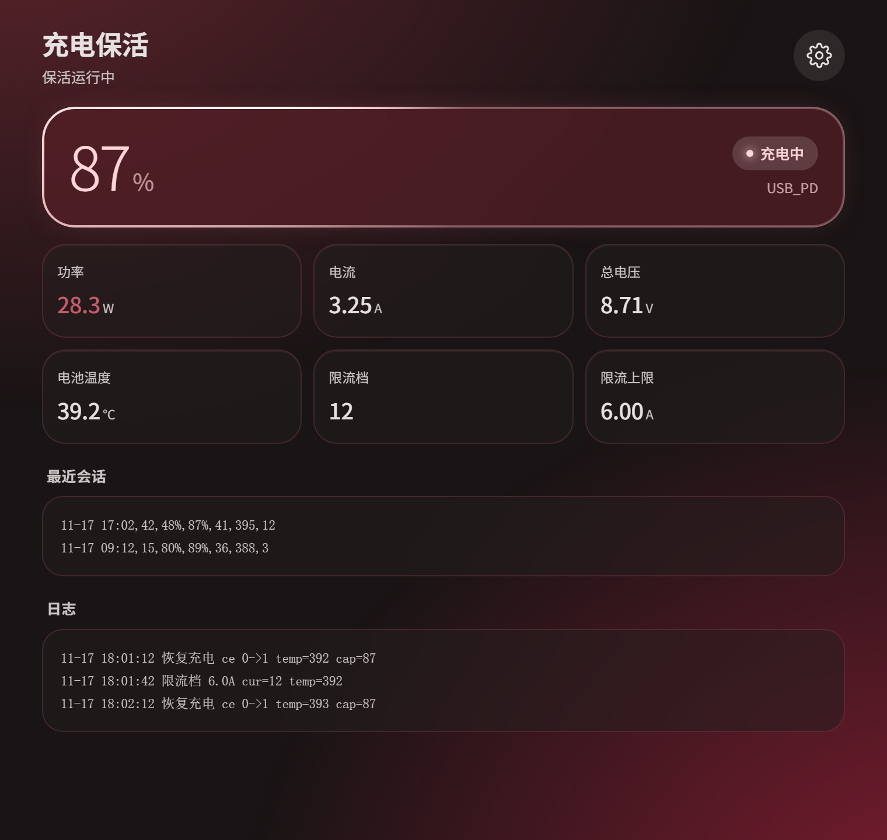
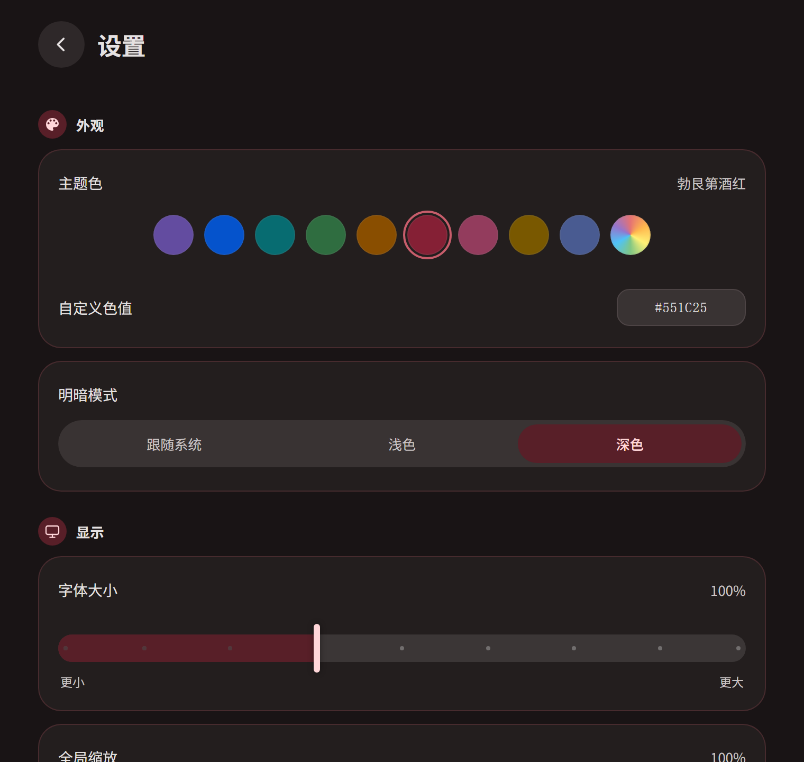
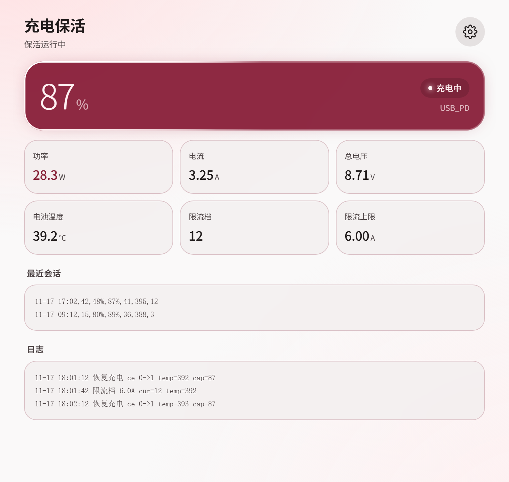

# Y700 ColorOS 充电保活

> 联想拯救者 Y700 四代（TB322FC）移植 ColorOS 16 后，充电断断续续 / 充不进去 / 锁屏反复弹充电动画的修复模块。
> KernelSU / SukiSU / Magisk 通用。当前版本 **v3.0**。

---

## 问题现象

刷入 ColorOS 16 移植包后：

- 充电断断续续，UI 每隔几秒弹一次充电动画
- 电量停滞甚至倒退，插着充电器也在放电
- 功率在 0 ~ 55W 之间无序跳变
- 充到 80% 就停，再也上不去

## 根本原因

由四个独立问题叠加而成：

### 1. 内核 UCSI 误报电源模式变化

```
UCSI: handle_ucsi_read_ack: [LENOVO_UCSI] port_num=1, change=0x0040,
      flag=0x400B, partner_type=2, opmode=3, dev_type=4
```

`change = 0x0040` 在 UCSI 规范里是 `POWER_OPERATION_MODE_CHANGE`，但 `opmode` 从头到尾都是 `3`
（"via VBUS, other"），**根本没变过**。驱动以约 0.78 秒的间隔反复报这个"变化"，
触发内核的 `battery_chg_update_usb_type_work`，顺手把
`/sys/class/power_supply/battery/charging_enable` 置 0。

置 0 之后充电被切断，PD 重新协商，然后又被恢复、又被切断 —— 这就是"断断续续"的来源。

### 2. `WHITE-LOAD-CHARGE` 服务空转

```
/system_ext/bin/WHITE-LOAD-CHARGE
```

它读的是 `/dev/fp8300/...`，那是 OPPO 自家充电 IC 的节点。Y700 没有这颗芯片，
`/proc/charger`、`/proc/charger_cp`、`/sys/class/oplus_chg` 全部不存在，
所以它每一轮都拿不到数据，然后反复开关 `charging_enable`。

它的 `.rc` 本身也是坏的（移植时换行丢失）：

```
    disabledon post-fs-data      ← "disabled" 和 "on post-fs-data" 粘在一起
```

`disabled` 标志失效，`class hal` 的服务被 init 自动拉起，停不下来。

### 3. 充电上限被锁死在 80%

`charge_control_end_threshold = 80`，但这个属性是只读的，`echo 100` 返回成功但值不变。

原因是 OPPO charger HAL 读不到 `/proc/charger`（同上），只能用它内置的默认值 80。
官方系统上 HAL 能读到真实数据，所以是 100。

### 4. 温度 / 电量没有任何分级限流

`cooling_device41`（type = `battery`）被内核温控压在高档位，
`charge_control_limit` 长期偏低；而移植过来的 OPPO 那套温控参数是照搬源机型的，
在 Y700 上并不适用。

## 模块做了什么

| 功能 | 实现 |
|---|---|
| **充电保活** | 持续检查 `charging_enable`，为 0 就写回 1 |
| **停用冲突服务** | 启动时 `stop white_load_charge`，运行中发现被拉起再停一次 |
| **绕过错误的 80% 上限** | 不再跟随 `charge_control_end_threshold`，按真实电量判断 |
| **温度阶梯限流** | 接管 `cooling_device`，按电池温度 + 板级温度分档 |
| **电量阶梯限流** | 80% 以上逐级降流，避免高 SOC 大电流 |
| **档位自动标定** | 首次插电扫描冷却档位，记录每档真实的限流值 |
| **充电会话统计** | 每次充电记录电量变化、平均功率、修复次数，输出 CSV |
| **状态页** | KSU 管理器内打开，实时显示电流 / 温度 / 限流档 / 日志 |
| **按需工作** | 只有真正在充电时才高频运行，其余时间静默 |

### 限流策略

温度档和电量档同时生效，**取两者中更保守的**（限流更小）：

```
温度档（电池 temp + quiet-therm 双条件）
  电池 < 39.0℃ 且 quiet < 44.0℃   →  最大电流（默认 6A）
  电池 < 41.0℃ 且 quiet < 45.0℃   →  2/3
  电池 < 43.0℃ 且 quiet < 46.0℃   →  1/2
  更高                             →  1/3

电量档（涓流）
  < 80%     不加限制
  80 ~ 89%  上限 5A
  90 ~ 94%  上限 3A
  >= 95%    上限 1.5A
```

### 何时工作，何时停止

`need_keepalive()` 的判定顺序**不能随意调整**：

```
1. 没接任何电源                          → 停止
2. 只接电脑 USB（USB_CDP / USB_SDP）      → 停止
3. status == Full                        → 停止
4. 电量 >= CAP_MAX（默认 100）            → 停止
5. charging_enable == 0                  → 保活
6. 持续放电 > 0.3A（连续 6 秒）            → 停止
7. 其余                                   → 保活
```

**为什么第 2、3、4 条必须排在 `charging_enable == 0` 之前？**

因为 `charging_enable = 0` 有两种截然不同的含义：

- **故障**：被内核 UCSI 误报打回 0 → 必须救
- **系统正常行为**：接了电脑 USB、满电、或者供电不足 → 不该救

如果先判 `ce == 0`，那么在电脑 USB 口上（内核会周期性把 `ce` 写 0）
模块就会每 10 秒被误判一次"需要保活"，来回空转；满电时同理。

### 为什么是 5 秒巡检而不是事件驱动

理想做法是纯事件驱动（拔电时阻塞、插电瞬间唤醒）。但这台机器上三条路都堵死了，都实测过：

| 方案 | 实测结果 |
|---|---|
| `inotifyd`（toybox / busybox） | 内核不产生 inotify 事件，连普通文件都收不到 |
| `logcat -T <时间>` | **dump 语义**，输出完即退出，收不到后续事件 |
| `logcat -t 0` | 系统不支持：`WARNING: -t 0 invalid, setting to 1` |
| `logcat` 默认 follow + awk 过滤历史 | 输出到管道有块缓冲，实时性为零 |
| `dmesg -w` | 拔电时内核根本不打印日志，等不到 |

所以退回到 `sleep 5` 静默自查：频率 0.2 次/秒，等待期间不写日志，实测累计 CPU 只有几十毫秒。
插电后最多 5 秒开始保活。

## 界面

模块自带状态页（KernelSU / SukiSU 的 WebUI），不需要额外装 App：

| 状态页 | 设置页 |
|---|---|
|  |  |

浅色模式：



配色从种子色经 OKLCH 推导 Material You 色盘，内置 9 套预设加自定义色值；
字号、全局缩放、卡片透明度与模糊度都能调；充电时电量卡边缘有一圈流动的光。

## 安装

需要已 root（KernelSU / SukiSU / Magisk）。

```bash
# KernelSU / SukiSU
ksud module install charge_keepalive_fix_v3.0.zip

# Magisk
在 Magisk App 中「从本地安装」选择 zip
```

装完**重启**生效。

也可以直接把仓库目录放进 `/data/adb/modules/charge_keepalive_fix/`，
但同样建议重启，让 supervisor 由 init 接管。

## 配置

改 `/data/adb/modules/charge_keepalive_fix/config.prop`，保存后约 3 秒生效，**不需要重启**。

```ini
ENABLE_CE=1             # 充电保活开关
ENABLE_THERMAL=1        # 温度阶梯开关
ENABLE_SOC_GUARD=1      # 电量阶梯开关
CE_TEMP_MAX=450         # 超过 45.0℃ 不再强制开充电
CAP_MAX=100             # 充电上限，达到就不再保活

MAX_CURRENT=6000000     # 最低温档目标电流（mA）

TEMP_6A=390             # 电池温度阈值，0.1℃
TEMP_4A=410
TEMP_3A=430
QUIET_6A=44000          # quiet-therm 阈值，0.001℃
QUIET_4A=45000
QUIET_3A=46000

SOC_80=80               # 电量分档边界
SOC_90=90
SOC_95=95
SOC_A_80=5000000        # 各段上限电流（mA）
SOC_A_90=3000000
SOC_A_95=1500000

IDLE_POLL=5             # 不在充电时的巡检间隔（秒）
IDLE_NEED=20            # 连续多少次放电才判定为"不在充电"
CHARGE_POLL=0.3         # 充电时的轮询间隔（秒，支持小数 0.2 ~ 1.0）
ENABLE_CALIBRATE=1      # 首次插电时自动标定冷却档位映射
```

`CHARGE_POLL` 调大更省电，但 `charging_enable` 被打回后恢复更慢；调小反之。
`IDLE_NEED` 的实际迟滞时长 = `CHARGE_POLL × IDLE_NEED`，默认 0.3 × 20 ≈ 6 秒。

硬件限流是离散档位，模块会选「不低于目标值的最小档位」，实际电流再由充电器与 PD 协商决定。

## 日志

```bash
adb shell su -c cat /data/local/tmp/charge_keepalive.log
```

正常输出示例：

```
===== worker 启动 ce=1 thermal=1 目标=6000000mA 档位=13/15/16/18 | 电量保护=1 档位=14/16/19 | 停顿自查=5s =====
stop white_load_charge -> stopped
cdev=/sys/class/thermal/cooling_device41 quiet=/sys/class/thermal/thermal_zone63/temp
限流档 max(6000000mA),soc>=90% (cur=16) temp=355 quiet=42593 cap=94
恢复充电 ce 0->1 temp=353 cap=94 累计=2次
```

以 `!!` 开头的行表示异常（语法错误、运行时崩溃等）。

## 档位标定

`cooling_device` 的 `cur_state` 和真实限流之间不是固定映射。实测同一档位：

| cur_state | 电量 60% 时 | 电量 90% 时 |
|---|---|---|
| 12 | 7.0 A | 6.5 A |

所以模块在**首次插电时**扫一遍 15 个档位，逐个读回 `charge_control_limit`，生成真实映射表，
存到 `cdev_map.cache`，之后一直复用。

- 耗时约 2 秒，期间电流会抖一下
- 标定结果会做单调性校验（cur 越大限流必须越小），被内核干扰则不采用，继续用内置表
- 想重新标定：删掉 `/data/adb/modules/charge_keepalive_fix/cdev_map.cache` 后重启模块
- 不想要：`ENABLE_CALIBRATE=0`

## 充电会话统计

每次充电结束后往 `/data/local/tmp/charge_sessions.csv` 追加一行：

```
date,dur_min,cap_from,cap_to,avg_w,max_temp_0.1C,ce_fixes
11-06 17:20,42,35%,78%,47,398,16
```

字段含义：起止时间、时长（分钟）、起止电量、平均充电功率、最高电池温度、期间修复 `charging_enable` 的次数。

时长不足 60 秒的会话不记录（多半是插拔抖动）。文件超过 200 行会自动截断保留最近 120 行。

这个数据能客观反映模块有没有起作用——比如 `ce_fixes` 从每小时上百次降到个位数，
或者 `avg_w` 是否稳定。

## 状态页

模块带一个 KSU WebUI 页面（`webroot/index.html`）。装好模块后，在 KernelSU / SukiSU 管理器里
进入模块详情，点「打开」即可。

显示内容：

- 电量、充电状态
- 电流 / 功率 / 电压 / 电池温度
- 当前限流档位与限流上限
- 最近 5 条充电会话
- 最近 9 行日志

每 2 秒自动刷新。如果当前管理器不支持 WebUI，页面会提示 `ksu.exec` 不可用。

## 热更新与自动回滚

```
service.sh        supervisor，只监控 worker，自身永不退出
worker.sh         实际逻辑，替换即热重载（约 3 秒）
worker.sh.bak     已知良好版本，出问题自动回滚到这里
config.prop       可调参数
```

两道保险：

1. 启动前 `sh -n` 语法检查，失败直接用 `.bak` 覆盖回去
2. 运行期若 5 秒内退出，连续 3 次判定为坏版本，同样回滚
3. 正常跑满 30 秒，把当前版本存为 `.bak`（所以备份永远是"真正跑起来过"的版本）

改坏了最坏情况是 2 秒内自动恢复，不会把充电搞停。

## 打包与版本

```bash
python build.py          # 打包当前版本
python build.py --list   # 列出已有产物
```

产物在 `releases/`：

| 文件 | 用途 |
|---|---|
| `releases/charge_keepalive_fix_v3.0.zip` | 当前版本，刷这个 |
| `releases/history/*.zip` | 每次内容变化前的自动备份（带时间戳） |
| `charge_keepalive_fix.zip` | 根目录快捷副本，始终指向最新 |

版本号取自 `module.prop` 的 `version` 行，WebUI 顶部的版本显示也是读它。

**只在有明显功能更新时才改版本号**。小修补直接重复打包：内容没变就只刷新时间戳，
内容变了则把旧包挪进 `history/` 再覆盖同名文件，不会丢历史，也不会堆垃圾。

## 已验证场景

| 场景 | 行为 |
|---|---|
| 只接电脑 USB（`USB_CDP`） | 停止，零日志零 CPU |
| 拔线 | 停止 |
| 满电 100% | 停止 |
| 掉到 99% | 5 秒内恢复，1.5A 涓流 |
| 插 PD 充电器（未满） | 5 秒内恢复保活 |
| 充电中 90~94% | 3A 限流，稳定 |
| 充电中 ≥95% | 1.5A 涓流 |

## 已知限制

- **这是对冲，不是根治。** `charging_enable` 被打回 0 的源头在内核 UCSI 驱动里，用户态只能不断写回。
  要彻底解决需要换内核（例如内核与 `vendor_dlkm` 模块配套的版本）。
- **`status` 仍会偶发闪一下。** 内核每次重置 `charging_enable` 时状态标记会短暂变化，
  UI 可能闪一下"未充电"，但实际电流不中断。
- **响应精度 5 秒。** 详见上文「为什么是 5 秒巡检而不是事件驱动」。
- **只针对 Y700 四代 + ColorOS 16 移植包。** 其他机型/系统请自行判断，
  `cooling_device` 编号、`usb/type` 取值、温区名称都可能不同。

## 免责声明

修改充电相关参数存在风险。模块会绕过系统对电池的一部分保护逻辑（例如错误的 80% 上限），
**请自行承担使用风险**。若设备出现异常发热、异味、电池鼓包，请立即断开电源并停用本模块。

首次使用建议人在旁边观察，确认没有异常发热。

## 许可证

[MIT](LICENSE)
